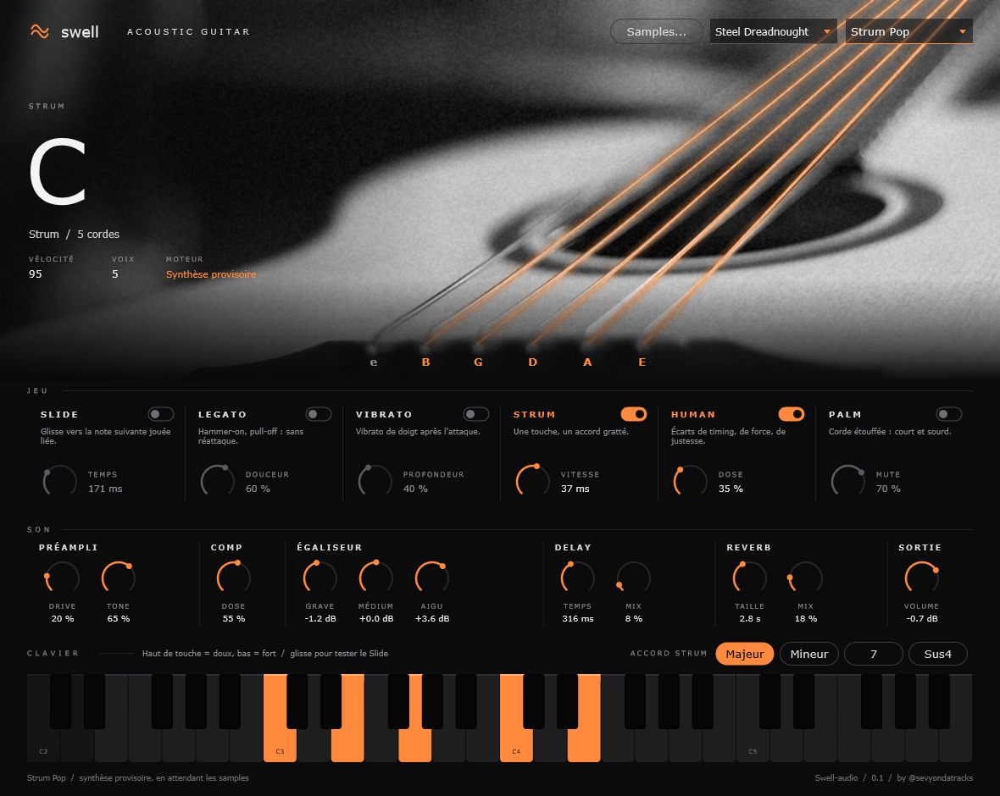
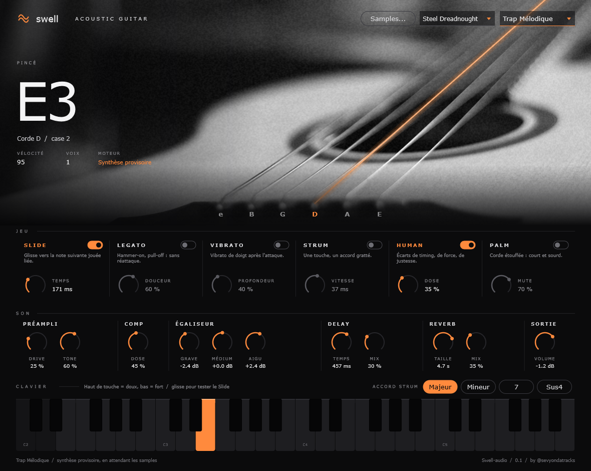

# Swell Guitar

Guitare **acoustique et électrique** VST3 / AU / Standalone de la suite **Swell** (Swell-audio, by @sevyondatracks). JUCE 8 + CMake.

> **v0.2** : deux guitares jouables tout de suite, chacune avec un sample intégré (`assets/samples/`) étiré sur tout le clavier.
> Acoustique = *RC20* (C4), Électrique = *Run* (C4). Le sélecteur de guitare charge le premier preset du type.

## Captures

**Strum** (preset Strum Pop, accord de C : 5 cordes allumées)

**Note seule** (preset Trap Mélodique, E3 sur la corde D, case 2)

## Ce qu'il y a
- **Moteur sampler** (`Source/GuitarEngine.*`, `Source/SampleLibrary.*`) : lit un dossier de WAV/AIFF/FLAC nommés par note
  (`Guitare_C3.wav`, `Guitare_F#2_forte_rr2.wav`), couches de vélocité (p / m / f), round-robin, recalage automatique de l'octave
  (la note la plus grave tombe sur C2..B2). Sans samples, une guitare synthétisée (Karplus-Strong) joue à la place.
- **Modules de jeu** : Slide (notes liées), Legato (hammer-on / pull-off), Vibrato, Strum (accord gratté, Maj / Min / 7 / Sus4),
  Humanize, Palm mute. Pitch bend ±2, molette = vibrato, pédale de sustain.
- **Effets** (`Source/FxChain.h`) : préampli (acoustique) ou ampli + baffle (électrique), compresseur, EQ 3 bandes, delay, reverb, volume.
- **Presets** : 6 acoustiques, 5 électriques (Clean Jazz, Crunch Rock, Lead Saturé, Palm Mute Heavy, Ambient Électrique).
- **Interface "Noir & Cordes"** (`Source/PluginEditor.*`) : photo noir et blanc, les 6 cordes s'allument en orange quand elles jouent.
  Prototype jouable dans `design/project/Main.dc.html`.

## Samples
Sans dossier, chaque guitare joue son sample intégré. Dossier par défaut : `Documents/Swell/Acoustic Guitar/Samples` et
`Documents/Swell/Electric Guitar/Samples` (ou bouton « Samples... », qui charge pour la guitare affichée). Samples **dry**, une note par fichier,
44,1 ou 48 kHz, laissés sonner jusqu'au bout, sans normalisation note par note.

## Build
Windows : `./build.ps1` (VS 2022 Build Tools + CMake). Mac : `./build-mac.sh`.

## Crédits
Photos (licence Pixabay, usage commercial autorisé, passées en noir et blanc) :
- Acoustique : [guitar-acoustic-music-5807916](https://pixabay.com/photos/guitar-acoustic-music-5807916/) par bunditua
- Électrique : [electric-guitar-guitar-strings-1846582](https://pixabay.com/photos/electric-guitar-guitar-strings-1846582/)
